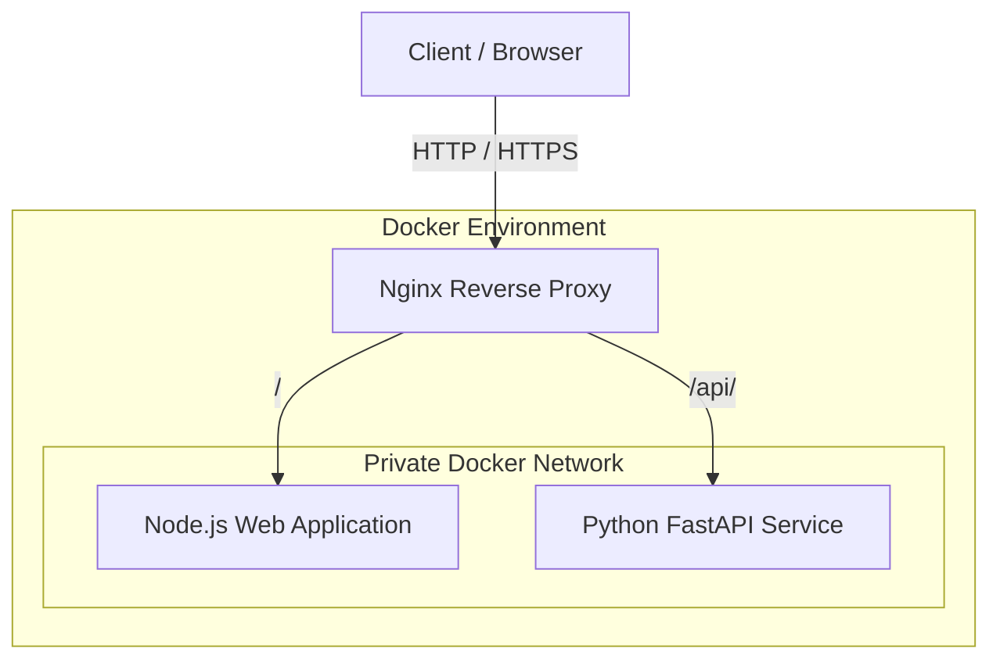

# Architecture

## 1. Architecture Overview

The solution uses Nginx as the central entry point for incoming client traffic.

Nginx forwards requests to separate backend applications based on the requested URL path.

The initial architecture consists of three services:

- Nginx: Reverse proxy.
- Node.js: Web application.
- Python FastAPI: Backend API.

Each service runs in its own Docker container. The services communicate over a private Docker network.

Only Nginx publishes ports to the host.

## 2. Architecture Diagram

## 3. Request Routing

Nginx will route requests according to their URL paths.

| Request path | Destination | Purpose |
|---|---|---|
| `/` | Node.js application | Web application |
| `/api/` | FastAPI service | API requests |

Nginx will forward requests to the appropriate backend service using the internal Docker network.

The proxy configuration will also handle the relevant request headers and upstream communication.

## 4. Network Design

The services will communicate over a private Docker network.

Docker Compose service names will be used for internal service discovery.

The intended network exposure is:

| Component | Host port published | Purpose |
|---|---|---|
| Nginx | Yes | Receives client requests |
| Node.js | No | Internal web application |
| FastAPI | No | Internal API service |

This ensures that client traffic enters through Nginx rather than accessing the backend applications directly.

## 5. TLS and Security

Nginx will handle TLS termination for incoming HTTPS connections.

The implementation will consider:

- HTTPS configuration.
- TLS certificate and private key management.
- Appropriate proxy headers.
- HTTP security headers.
- Restriction of unnecessary network exposure.
- Container and application security.

The local TLS configuration and AWS certificate management approach will be considered separately because the two deployment environments have different requirements.

## 6. Logging and Operational Visibility

Nginx will provide access and error logs for incoming requests and proxy activity.

The backend applications will also provide health endpoints to support service availability checks.

Operational validation will include:

- Successful request routing.
- Backend health checks.
- Upstream connection failures.
- Behaviour when a backend is unavailable.
- Investigation of relevant application and proxy logs.

## 7. Deployment Architecture

### Local Environment

Docker Compose will manage the three services and their private network.

This environment will be used to validate the application behaviour, reverse proxy configuration, TLS and service communication.

### AWS Environment

The solution will subsequently be evaluated for deployment on AWS.

Terraform will manage the cloud infrastructure.

The AWS design will consider:

- Network segmentation.
- Public and private access.
- Security groups.
- IAM permissions.
- TLS certificate management.
- Logging and monitoring.
- Infrastructure cost and cleanup.

The final AWS architecture will be documented once the deployment design has been established.

## 8. Architectural Considerations

The separation of Nginx and the backend applications provides a clear division of responsibilities.

Nginx handles inbound traffic and request routing, while the backend applications handle their respective application responsibilities.

The use of separate application runtimes demonstrates how a reverse proxy can route requests to independently running services.

A database is not required for the initial scope. Additional infrastructure will only be introduced where there is a clear requirement.